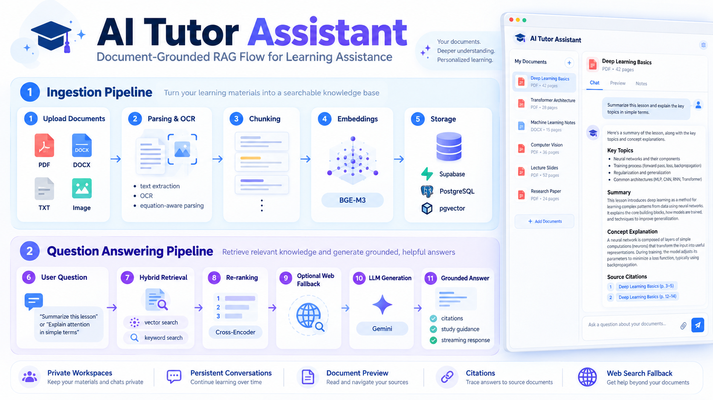
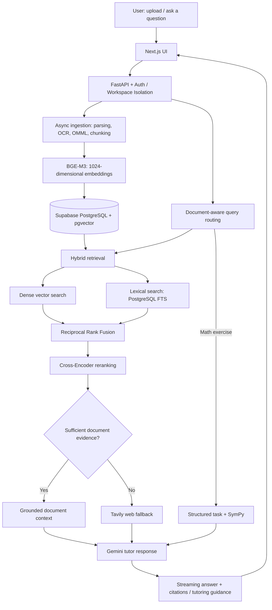

<div align="center">

# AI Tutor Assistant

**A document-grounded AI learning assistant with hybrid RAG, source citations, web fallback, and verified math solving.**

<p align="center">
  
</p>

[**Live Demo**](https://ai-tutor-document-grounded.vercel.app) · [**Source Code**](https://github.com/mth1805/ai-tutor-document-grounded) · [**Deployment Guide**](docs/deployment.md)


</div>

## Overview

AI Tutor lets users upload study materials and ask questions in natural language. Unlike a general chatbot, it **prioritizes evidence from the user's own documents**, provides page-level citations, and turns to web search only when document evidence is insufficient. It also supports guided learning and SymPy-backed mathematical computation.

**Key capabilities:** private workspaces and chat history · PDF/DOC/DOCX/TXT/image ingestion · OCR and Word equation extraction · document-aware questions and summaries · source-linked answers · streaming responses · three tutoring modes · verified math operations.

## End-to-End Architecture



## Technical Highlights

| Design decision | Why it matters |
|---|---|
| **BGE-M3 + pgvector HNSW** | Multilingual semantic retrieval for English/Vietnamese materials, with vector search persisted in PostgreSQL. |
| **Hybrid retrieval + RRF** | Combines semantic relevance with exact-term matching; fuses candidate rankings before reranking. |
| **Cross-Encoder reranking + relevance gate** | Scores query–chunk pairs more precisely and decides whether available document evidence is sufficient. |
| **Document-first + web fallback** | Avoids replacing uploaded material with generic web answers; falls back to Tavily when document evidence is insufficient. |
| **Citations & document reference resolution** | Connects answers to source pages and resolves references such as “this file” using authorized workspace context. |
| **SymPy-verified math** | Separates deterministic computation from LLM explanation; supports equations, derivatives, integrals, simplification, and arithmetic. |
| **Secure, asynchronous architecture** | Supabase Auth/RLS, private storage, background ingestion, streaming via SSE, and persistent workspaces/conversations. |

### Learning behavior

The same verified result can be presented in **Light Guidance** (hint), **Detailed Guidance** (guided steps), or **Full Solution** (complete explanation). DOCX OMML fractions and powers are preserved as searchable mathematical text when extracting learning materials.

## Evaluation & Deployment

- **Evaluation:** RAGAS-based retrieval/answer evaluation, citation correctness/completeness, and latency tracking. See the evaluation artifacts for dataset-specific results; do not interpret them as guarantees on unseen documents.
- **Local:** Docker Compose runs the frontend, FastAPI backend, and ingestion worker on CPU.
- **Cloud:** Next.js on Vercel; API/worker deployment via Modal; Supabase provides Auth, PostgreSQL/pgvector, and private Storage. Modal ingestion can use CPU by default or opt in to GPU.

## Run Locally

```bash
cp .env.example .env
cp frontend/.env.example frontend/.env.local
docker compose up --build
```

Open **http://localhost:3000**. Configure the development Supabase project and required environment variables before testing authenticated uploads. No GPU is required for local Docker.

For detailed setup, migrations, deployment, and implementation notes, see **[Deployment](docs/deployment.md)**, **[Local Docker](docs/local-docker-runtime.md)**, **[Math Solver](docs/phase9_1_verified_math_solver.md)**, and **[DOCX Equation Handling](docs/docx-equations-sidebar.md)**.
